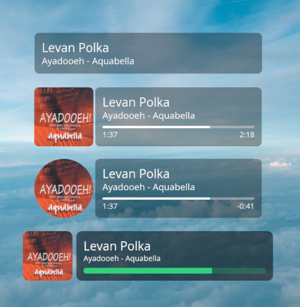

#  obs-dbus-mpris

*Ce README existe aussi en [français](README.md).*

A plugin for OBS Studio on Linux that adds one thing: a "Now Playing (MPRIS)" source, which shows what your media player is playing. Cover, title, artist, album and progress are read from the D-Bus session bus, through the MPRIS interface that mpv, VLC, web browsers, Strawberry, Elisa and many others provide.

<p align="center"></p>

## What the plugin does

- **One source, nothing else.** No entry in the Tools menu, no dock, no global setting, no file written to disk. Everything is set in the properties of the source, and several sources can each follow their own player, with their own style. As with any OBS source, a source pasted as a reference (Ctrl+V) or added with "Add Existing" shares its settings with the original: for separate settings, create a new source, or paste it as a duplicate (Edit menu, "Paste (Duplicate)").
- **A complete source.** Cover, title, an "Album - Artist" subtitle, progress bar, position and duration (or remaining time) are drawn by the source itself. Each element can be shown or hidden.
- **A careful rendering.** Cover on the left or the right, round or square, rounded corners, four colors with transparency, three font sizes. Texts too long for their line scroll, and Japanese, Chinese or Korean characters show as soon as a font has them.
- **A player selection designed for live streaming.** At startup the source finds your usual player, then never changes on its own (see below).
- **An online cover, only if you ask for it**, for players whose cover OBS Flatpak cannot read.

## Install

You need OBS Studio 32 or later, on Linux x86_64. The files to download are attached to each [release](https://gitlab.com/iglou.eu/obs-dbus-mpris/-/releases).

### With OBS from Flatpak

Download `obs-dbus-mpris-<version>-x86_64.flatpak`, then:

```sh
flatpak install --user obs-dbus-mpris-<version>-x86_64.flatpak
flatpak override --user --talk-name='org.mpris.MediaPlayer2.*' com.obsproject.Studio
```

The second command lets OBS talk to the players on the session bus. A Flatpak extension cannot grant this permission itself, and OBS does not ask for it by default. Then restart OBS.

To update, install the new bundle with `flatpak install --user --reinstall`. To uninstall: `flatpak uninstall --user com.obsproject.Studio.Plugin.DbusMpris`.

### With OBS installed natively

Download `obs-dbus-mpris-<version>-x86_64-linux.tar.gz`, then:

```sh
mkdir -p ~/.config/obs-studio/plugins
tar -xzf obs-dbus-mpris-<version>-x86_64-linux.tar.gz -C ~/.config/obs-studio/plugins/
```

You need glibc 2.36 or later (Debian 12, Ubuntu 24.04 and newer). To uninstall: `rm -r ~/.config/obs-studio/plugins/obs-dbus-mpris`. The plugin is developed and validated with OBS Flatpak, this native build has not been tried in a native OBS yet.

### Fonts

For titles in Japanese, Chinese or Korean, install a CJK font on your system: `noto-fonts-cjk` (Arch), `fonts-noto-cjk` (Debian, Ubuntu), `google-noto-sans-cjk-fonts` (Fedora). OBS Flatpak uses the fonts of the host. An emoji font (`noto-fonts-emoji`, `fonts-noto-color-emoji`) gives the default picture 🎼 when a cover is missing, otherwise the slot stays plain.

## Use it

Add a "Now Playing (MPRIS)" source to a scene. Its properties come in five groups:

- **Player**: the followed player, one entry per running instance, labeled by the player name and what it plays ("mpv - Mamona"), and automatic selection.
- **Displayed elements**: whether to show each element, remaining time in place of the duration, and the online cover.
- **Layout**: total width, height (0 lets it follow the fonts, otherwise the sizes scale to fill it in their proportions), cover on the right, round cover, gap between the cover and the panel, corner radius, progress bar thickness.
- **Text**: the three font sizes, the scrolling speed and pause (0 turns scrolling off, texts too long then end with "…"), and the message shown when nothing plays.
- **Colors**: background, text, progress bar fill and track, all with transparency.

### How the player is chosen

During the five minutes after the source starts, it looks for your usual player: the saved instance, else another instance of the same player (mpv restarted, for example), else another player, preferably one that is playing. This leaves you time to start your music after OBS.

After that, the source never changes on its own: another player starting in the middle of a stream never takes the place of the one shown. If that player closes, the source shows the fallback message and waits for it. A player chosen by hand in the properties is final as soon as it is chosen, and "Cancel" restores the selection as it was. Unchecking "Automatic selection" restricts the source to the saved instance, and to it alone.

## Privacy

By default, the plugin sends no network request. The online cover is chosen source by source, among three services:

- **MusicBrainz**, the free music database, with images from the Cover Art Archive. The service receives the title, artist and album.
- **Wikipedia**, for well-known records. The service receives the artist with the album or the title.
- **YouTube**, the video thumbnail, when the player gives the page address (LibreWolf or Firefox, not Chrome). The image is served by Google.

A lookup only happens when the player gives no readable cover, once per track and per service, failures included.

## Build from source

You need Rust (the version is pinned by `rust-toolchain.toml`) and, for the tests, `dbus-daemon`. The libobs bindings are generated ahead of time and versioned: neither the OBS headers nor libclang are needed.

```sh
git clone https://gitlab.com/iglou.eu/obs-dbus-mpris.git
cd obs-dbus-mpris
cargo test --workspace         # tests, each on its own private D-Bus bus
scripts/install-dev.sh         # builds and installs into OBS Flatpak
scripts/install-dev.sh --native   # or into a native OBS
scripts/package-native.sh      # native release archive, in target/dist
scripts/build-flatpak.sh       # offline Flatpak extension and its bundle
```

`install-dev.sh` refuses to install a library OBS could not load (glibc too recent, missing libobs symbol). It also refuses to install while the Flatpak extension of the plugin is installed: OBS loads the extension first and skips the user folder copy, with nothing but a "Skipping legacy plugin" line in its log. Uninstall the extension while developing (`flatpak uninstall com.obsproject.Studio.Plugin.DbusMpris`). `scripts/build-flatpak.sh` needs OBS Flatpak (stable branch), `org.freedesktop.Sdk//25.08` and its `rust-stable` extension.

The `cargo run --example watch` example prints in the terminal what a source would show, from your real players, without OBS.

## How the code is organised

- `crates/mpris-core/`: the core, without OBS. Data model, selection rules, D-Bus adapter, local and online covers.
- `crates/render/`: the layout and drawing of the source, without OBS.
- `crates/obs-mpris/`: the library OBS loads, and the translations in `data/locale/`.
- `crates/libobs-sys/`: the libobs bindings, regenerated by `scripts/gen-libobs-bindings.sh`.
- `packaging/flatpak/`: the manifest of the Flatpak extension.
- `docs/`: vision, requirements, architecture and roadmap, in French.

## License and credits

The plugin is under the [GPL-3.0-or-later](LICENSE) license. Online covers come from [MusicBrainz](https://musicbrainz.org/) and the [Cover Art Archive](https://coverartarchive.org/), from [Wikipedia](https://www.wikipedia.org/) and from YouTube, and remain the property of their authors. Text is rendered by [cosmic-text](https://github.com/pop-os/cosmic-text). The logo takes after the spirit of the OBS Studio logo, without being an official derivative of it. OBS Studio is a project independent from this plugin.
